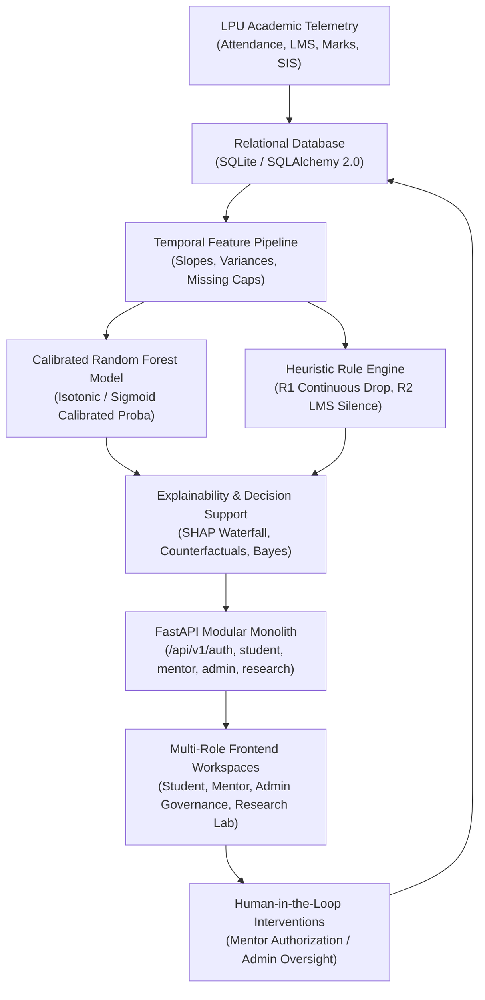

# LPU-RISK-01: Academic Early-Warning & Intervention Decision System
**Explainable Academic Early-Warning, Multi-Role Intelligence & Human-in-the-Loop Governance**  
*Lovely Professional University (LPU) • School of Computer Science & Engineering (CSE276: AI Foundations)*

<p align="center">
  <a href="https://earlywarningdetection.onrender.com/login"></a>
  <a href="https://earlywarningdetection.onrender.com/api/v1/docs"></a>
  
  
  
</p>

<p align="center">
  
  <br />
  <em>“Find focus, peace, and explainable insight in every academic decision.” — Calibrated Risk Model Active</em>
</p>

---

## 1. System Overview

**LPU-RISK-01** transforms passive academic performance monitoring into a proactive, transparent, and ethically governed decision-support platform. The system ingests continuous evaluation, LMS engagement, and weekly attendance telemetry across university cohorts, identifies students navigating academic friction, explains the underlying causal factors using TreeSHAP and heuristic rules, and empowers faculty mentors and administrators to authorize targeted recovery interventions with complete auditability.



---

## 2. Core Architecture & Tech Stack

| Layer | Technologies | Role & Responsibility |
|---|---|---|
| **Frontend Workspaces** | Google Stitch HTML5, Tailwind CSS, Material Design 3, Chart.js 4.4 | Multi-role user interfaces: Eduvance Login Portal, Student Workspace, Mentor Decision Workspace, Institutional Admin Governance Dashboard, and Research Lab. |
| **Backend API** | Python 3.11+, FastAPI, Pydantic V2, Starlette | Modular RESTful API with versioning (`/api/v1`), JWT authentication, and strict RBAC data isolation. |
| **Database & ORM** | SQLite (`database/lpu_risk_system.db`), SQLAlchemy 2.0 | 21 relational entities including `MentorMeeting`, idempotent ingestion pipeline for 60 synthetic LPU students across 3 sections. |
| **ML Engine** | Scikit-learn, NumPy, Pandas, TreeSHAP, SciPy | Calibrated Random Forest Early Warning Model, Logistic Regression baseline, Decision Tree, HistGradientBoosting challenger, K-Means clustering, and temporal cutoffs (W2, W4, W6, W8). |
| **Search State-Space** | BFS, DFS, Best-First Search, Hill Climbing, A* Search ($f = g + h$) | 8 planning states, 12 transitions, admissible heuristics $h(n)$, and multi-algorithm comparative benchmark runner. |
| **Knowledge & Logic** | Minsky Frames, First-Order Predicates, Production Rules R1–R4, Propositional Logic AST, Semantic Network | Explicit formal logic reasoning, 16-row truth table generator, and cohort-level universal ($\forall$) and existential ($\exists$) quantifiers. |
| **Explainability & Bayes** | SHAP Waterfall Attributions, Counterfactual What-Ifs, Transparent Bayesian Inference | Pedagogical decomposition for mentors; non-stigmatizing focus cards for students; normalized $P(H\|E)$ calculations with telemetry-enriched observed values. |
| **Testing & QA** | PyTest, HTTPX, StaticPool In-Memory SQLite | Comprehensive **76-test automated regression suite** covering database, auth, RBAC, student, mentor, admin governance, ML, search, knowledge, and research endpoints. |

---

## 3. Seeded Demo Credentials

| Role | Username / ID | Password | Persona & Assignment | Intended Dashboard Route |
|---|---|---|---|---|
| **Student** | `12511001` | `student123` | **Aarav Sharma** (B.Tech CSE Hons, Sec K3P25IL, 82% Att, MTH401 drop) | `http://localhost:8000/student` |
| **Faculty Mentor** | `m08` | `mentor123` | **Dr. Manoj Saini** (Associate Professor, 10 Mentees including Aarav) | `http://localhost:8000/mentor` |
| **Institutional Admin** | `admin` | `admin123` | **Dr. Rajesh Verma** (Dean of Academic Affairs / Institutional Operations) | `http://localhost:8000/admin` |
| **Researcher / Evaluator** | *Direct link* | — | Evaluator Workspace for CSE276 Syllabus Demonstrations | `http://localhost:8000/lab` |

*Quick Demo Switcher:* The floating demo switcher pill at the bottom right of all interfaces allows seamless one-click switching between all four roles without manual credential re-entry.

---

## 4. Quick Start

### Installation

```bash
# Clone the repository
git clone https://github.com/Mohitku-Panigrahi/EarlyWarningDetection.git
cd EarlyWarningDetection

# Create and activate virtual environment (optional but recommended)
python -m venv venv
# On Windows:
.\venv\Scripts\activate
# On Linux/macOS:
source venv/bin/activate

# Install dependencies
pip install -r requirements.txt
```

### Option A: One-Click Launch Scripts (Recommended)

**On Windows:**
Double-click `start.bat` or run:
```powershell
.\start.bat
# Or using PowerShell runner:
.\scripts\run_app.ps1
```

**On Linux / macOS:**
```bash
chmod +x start.sh
./start.sh
```

These scripts:
1. Initialize the SQLite database and seed 60 students and 6 mentors (`python -m backend.app.scripts.seed_demo_data`).
2. Verify all ML engine, knowledge representation, and heuristic search modules.
3. Start the Uvicorn web server on `http://127.0.0.1:8000`.

### Option B: Manual Execution

```bash
# 1. Initialize and seed synthetic cohort dataset
python -m backend.app.scripts.seed_demo_data

# 2. Launch FastAPI backend & served frontend
python -m uvicorn backend.app.main:app --host 127.0.0.1 --port 8000 --reload
```

Open your browser to:
- **Login Portal:** [http://localhost:8000/login](http://localhost:8000/login)
- **Student Dashboard:** [http://localhost:8000/student](http://localhost:8000/student)
- **Mentor Workspace:** [http://localhost:8000/mentor](http://localhost:8000/mentor)
- **Admin Governance Dashboard:** [http://localhost:8000/admin](http://localhost:8000/admin)
- **Research & Algorithm Lab:** [http://localhost:8000/lab](http://localhost:8000/lab)
- **Interactive API Documentation (Swagger):** [http://localhost:8000/docs](http://localhost:8000/docs)
- **Alternative API Documentation (ReDoc):** [http://localhost:8000/redoc](http://localhost:8000/redoc)

---

## 5. Directory Structure

```
.
├── backend/
│   ├── app/
│   │   ├── api/
│   │   │   ├── deps.py                       # RBAC guards & student/mentor data isolation
│   │   │   └── v1/                           # Versioned API routes
│   │   │       ├── auth.py                   # Login, profile, password reset
│   │   │       ├── student.py                # Student KPI cards, subjects, tasks
│   │   │       ├── mentor.py                 # Roster, SHAP explainability, recommendations, meetings
│   │   │       ├── interventions.py          # Approve / Reject / Complete workflows
│   │   │       ├── admin.py                  # Institutional stats, heatmaps, model health
│   │   │       ├── admin_governance.py       # Master Mentor Governance & Oversight APIs
│   │   │       └── research.py               # Search, knowledge, Bayesian & benchmark APIs
│   │   ├── core/                             # Configuration & PBKDF2/JWT security
│   │   ├── database/                         # SQLAlchemy engine & session management
│   │   ├── models/                           # 21 Relational SQLAlchemy models (incl. MentorMeeting)
│   │   ├── schemas/                          # Pydantic V2 request & response schemas
│   │   ├── scripts/                          # Database seed CLI (seed_demo_data.py)
│   │   └── services/                         # Ingestion pipeline & business logic
│   └── tests/                                # 76 Automated unit and integration tests
├── ml_engine/
│   ├── decision_support/                     # 4-stage pipeline (Monitor->Risk->Explain->Plan)
│   ├── evaluation/                           # Metrics (Recall@K, PR-AUC, Brier, Temporal W2-W8)
│   ├── explainability/                       # SHAP waterfall, Counterfactuals, Bayes Net
│   ├── knowledge/                            # Knowledge Representation Engine (Unit II)
│   ├── models/                               # Calibrated Random Forest, Baselines, Challenger
│   ├── preprocessing/                        # Temporal rolling feature extractor
│   ├── rules/                                # Heuristic Rule Engine (R1 - R4)
│   └── search/                               # Intervention State-Space Search (Unit II)
├── frontend/                                 # Integrated responsive dashboards
│   ├── login.html                            # Multi-role authentication portal
│   ├── student.html                          # Student academic workspace & habit streak tracker
│   ├── mentor.html                           # Mentor decision, explainability & meeting workspace
│   ├── admin.html                            # Institutional admin & mentor governance dashboard
│   └── lab.html                              # Interactive Research & Algorithm Lab
├── database/                                 # SQLite database storage (lpu_risk_system.db)
├── documentation/                            # Documentation suite & visual screenshots
│   ├── screenshots/                          # High-fidelity dashboard & portal screenshots
│   ├── DESIGN_SYSTEM.md                      # UI/UX design tokens and component specification
│   ├── DESIGN_CONSULTATION.md                # System design & architecture consultation transcript
│   └── *.md                                  # Search, Bayesian, and Knowledge specification docs
├── scripts/                                  # Automation & dataset generation scripts
│   ├── run_app.ps1                           # PowerShell launch & verification script
│   └── generate_standalone_data.py           # Standalone data generation utility
├── .env.example                              # Environment configuration template
├── .gitignore                                # Git ignore configuration
├── requirements.txt                          # Production Python dependencies
├── start.bat                                 # Windows one-click launcher
├── start.sh                                  # Linux/macOS launcher
└── README.md                                 # Technical documentation & project guide
```

---

## 6. Latest Updates & Engineering Changelog

### Phase 1: Student Academic Habit & Streak Engine (`frontend/student.html`)
* **Daily Academic Habit Tracker:**
  * Implemented an engaging daily habit tracker featuring 4 configurable habits: *Daily Revision*, *Lecture Attendance*, *Assignment Progress*, and *Problem Solving*.
  * Built an 84-day contribution heatmap and first-screen compact monthly streak matrix ($7 \times \text{weeks}$ layout).
  * Calculates current streak, best streak, and consistency percentages with persistent browser state.
  * **Critical Telemetry Guardrail:** Student habit checks are strictly treated as self-reported engagement data. They never overwrite official university attendance, LMS records, or grading telemetry.
* **Information Architecture Restructuring:**
  * Reorganized into 5 navigable views: `Overview`, `Academic Progress`, `My Subjects`, `My Tasks`, and `Habits & Consistency`.
  * Longitudinal trajectory visualization showing W1–W6 observed (solid line) and W7–W8 model projected (dashed line) against the 75% cutoff benchmark.
  * Dedicated task workspace supporting filters for `All`, `My Tasks`, `Mentor Assigned`, `Completed`, and `Overdue`.

### Phase 2: Mentor Explainability Bug Resolution & Analytics (`frontend/mentor.html`)
* **Root Cause Fix for `undefined (undefined)` SHAP Bug:**
  * Resolved serialization mismatch where raw model feature keys lacked human-readable names and observed values.
  * Expanded `ShapFeatureContribution` schema and implemented `_enrich_shap_feature()` in `backend/app/api/v1/mentor.py` joining `StudentSubjectPerformance` to display human-readable feature names, actual observed values (e.g. *Discrete Mathematics at 54.0%*), and explicit directional impact labels (*Increases / Reduces predicted risk*).
* **Mentor Academic Analytics & Longitudinal Velocity:**
  * Implemented `GET /api/v1/mentor/analytics` and `GET /api/v1/mentor/mentees/{id}/trajectory`.
  * Computes Ordinary Least Squares (OLS) regression slope over weeks W1–W6 ($x=[1..6]$, $y=\text{weekly assessment score}$) to classify trajectory momentum as **Improving** ($\text{slope} > +0.8$), **Declining** ($\text{slope} < -0.8$), or **Stable**.
  * Renders cohort comparative standing ($N=10$) and subject benchmark matrices against the 75% university cutoff.
* **Intelligent Task Recommendation Engine:**
  * Implemented `GET /api/v1/mentor/recommendations` automatically detecting assessment or attendance deficits below 75%.
  * Added action workflows for **Approve & Assign**, **Dismiss** (with mandatory pedagogical justification logging), and **Bulk Approve**.
* **Formal Mentoring Meeting Workflow:**
  * Added `POST /api/v1/mentor/meetings` and `GET /api/v1/mentor/meetings` enforcing mentor cohort isolation.
  * Mentors can record 1-on-1 sessions with duration, discussion summaries, academic concerns, agreed actions, and next follow-up dates directly from the mentor workspace header and student drawer.

### Phase 3: Admin Mentor Governance & Student Oversight Dashboard (`frontend/admin.html`)
* **Institutional Governance Layer:** Transformed Pane 3 of the Admin Dashboard into a comprehensive 5-tab governance workspace:
  1. **Governance Overview:** 6 institutional KPIs, horizontal Mentor Workload Bar Chart (quota cap: 10), stacked Student Support Distribution Chart (On Track, Watch, Needs Review), and an actionable Institutional Attention Queue.
  2. **Mentor Performance:** Searchable mentor directory with quota utilization bars, task completion velocity, and a slide-over **Mentor Governance Profile Drawer** (Assigned Cohort Health, Academic Support Tasks, Mentoring Engagement & Weekly Cadence, Intervention Directives).
  3. **Student-Mentor Relationships:** Searchable, filterable matrix across sections and mentors with attendance, assessment, active/completed tasks, last session, next follow-up, and a slide-over **Student Governance Detail Drawer**.
  4. **Meeting & Follow-up Monitoring:** 4 meeting KPIs, weekly session cadence chart, modality doughnut (In Person, Online, Phone), priority students awaiting follow-up queue, complete institutional session log, and descriptive empty-state handling.
  5. **Intervention Oversight:** Directive status counters, master interventions table, and an **Administrative Review Modal** supporting `add_administrative_note`, `flag_for_review`, and `request_clarification` backed by immutable audit logging.
* **Backend Governance Router (`backend/app/api/v1/admin_governance.py`):** Mounted 12 versioned endpoints secured with `require_admin`.

---

## 7. API Reference Summary

### Authentication (`/api/v1/auth`)
- `POST /login` — Authenticate and receive JWT bearer token.
- `GET /me` — Current authenticated user profile with role.
- `POST /change-password` — Secure password update.

### Student Experience (`/api/v1/student`)
- `GET /dashboard` — 4 KPI cards, 8-week trend series, 7 subjects, explainability factor cards.
- `GET /tasks` & `PATCH /tasks/{id}` — Live task status toggle (Pending ↔ Completed).
- `POST /tasks` — Add custom self-study task.
- `DELETE /tasks/{id}` — Delete personal self-study task (mentor-assigned tasks protected).

### Faculty Mentorship (`/api/v1/mentor`)
- `GET /dashboard` — Mentee risk distribution, priority review queue, cohort telemetry.
- `GET /mentees` — Paginated and searchable roster of assigned mentees.
- `GET /mentees/{student_id}/risk` — Deep explainability payload with enriched SHAP attributions, rules fired, and counterfactuals.
- `GET /mentees/{student_id}/trajectory` — Longitudinal trajectory with OLS slope and cohort comparison.
- `GET /analytics` — Cohort status distribution and subject benchmark averages.
- `GET /recommendations` — Intelligent subject-specific recovery recommendations.
- `POST /recommendations/{id}/approve` & `POST /recommendations/{id}/dismiss` — Review recommendation.
- `POST /recommendations/bulk-approve` — Bulk approve all pending recommendations.
- `POST /meetings` & `GET /meetings` — Log and list mentoring sessions.
- `GET /meetings/{id}` & `PATCH /meetings/{id}` — Retrieve and update session records.
- `POST /tasks` & `GET /tasks` — Assign and monitor academic tasks.

### Admin Mentor Governance & Oversight (`/api/v1/admin/governance`)
- `GET /overview` — Institutional KPIs and priority attention queue.
- `GET /mentor-workload` — Mentor capacity, allocated students, remaining capacity, load percentage.
- `GET /student-distribution` — On Track, Watch, Needs Review breakdown per mentor.
- `GET /mentors` — Searchable mentor directory with academic support and meeting metrics.
- `GET /mentors/{id}` — 4-group consolidated mentor governance profile.
- `GET /relationships` — Student-mentor relationship matrix with search, filters, and pagination.
- `GET /students/{id}/governance` — Detailed student governance drawer (trajectory, weak subjects, meetings, tasks).
- `GET /meetings/analytics` — Meeting volume, weekly cadence, and modality breakdown.
- `GET /meetings` — Paginated institutional meeting records log.
- `GET /followups` — Priority queue of upcoming and overdue follow-up check-ins.
- `GET /interventions` — Master intervention directives oversight feed.
- `POST /interventions/{id}/review` — Record administrative review action (`add_administrative_note`, `flag_for_review`, `request_clarification`).

### Institutional Administration (`/api/v1/admin`)
- `GET /dashboard` — Monitored student totals (60), Section distribution, Section-Subject heatmaps, Priority Signals.
- `GET /students` — Global student roster with filters.
- `GET /model-health` — Brier score, PR-AUC, calibration drift, inference latency.
- `GET /fairness` — Demographic parity ratios across admission routes and schooling boards.
- `GET /audit-logs` — Immutable SHA-256 governance ledger.
- `GET /system-settings` & `PUT /system-settings` — Threshold tuning and operational parameters.

### Research & Algorithm Lab (`/api/v1/research`)
- `GET /search/graph` — Serialized 8-state, 12-transition academic intervention graph.
- `POST /search/execute` — Execute individual algorithm (BFS, DFS, Best-First, Hill Climbing, A*).
- `GET /search/comparison` — Benchmark all 5 search algorithms simultaneously.
- `GET /knowledge/semantic-network` — Nodes and edges of academic concept ontology.
- `POST /knowledge/evaluate` — Evaluate Frames, Predicates, Rules R1–R4, and Propositional Logic for a student.
- `GET /knowledge/truth-table` — 16-row propositional logic truth table.
- `POST /bayesian/update` — Compute $P(H|E)$ with likelihoods, marginals, and normalization proofs.
- `GET /models/comparison` — Supervised model comparison and K-Means student personas.
- `GET /dataset/summary` — Cohort metrics, distributions, and zero-leakage documentation.

---

## 8. Verification & Testing

The entire system is covered by **76 automated tests**:

```powershell
python -m pytest backend/tests -q
```

**Test Coverage Summary:**
- `test_database.py` (3 tests): Table schemas, foreign keys, password hashing, unique constraints.
- `test_import_service.py` (3 tests): 60-student import, idempotence, Aarav Sharma persona verification.
- `test_auth.py` (11 tests): Login flows for all 3 roles, forged tokens, student/mentor isolation guards.
- `test_student_api.py` (4 tests): Dashboard KPIs, task toggles, custom tasks, peer isolation.
- `test_mentor_api.py` (6 tests): Workload telemetry, Explainability Drawer, approve/reject intervention workflow.
- `test_mentor_analytics_and_recommendations.py` (4 tests): Enriched SHAP attributes, cohort analytics, OLS trajectory slope, intelligent recommendations.
- `test_task_engine.py` (1 test): Student and mentor shared task workflows, RBAC cross-cohort boundaries, personal deletion permissions.
- `test_admin_api.py` (9 tests): Dashboard aggregates, heatmaps, model health, fairness audits, settings.
- `test_admin_mentor_governance.py` (7 tests): Mentor meeting logging, cross-cohort isolation (403), governance overview, workload distribution, mentor directory, relationship matrix, student drawer, meeting analytics, follow-ups queue, and administrative review notes.
- `test_ml_engine.py` (6 tests): Feature extraction, Calibrated Random Forest, rule engine heuristics, counterfactuals, Bayesian inference, decision pipeline.
- `test_search_engine.py` (7 tests): State-space graph, BFS, DFS, Best-First, Hill Climbing, A* cost-optimality, runner comparison.
- `test_knowledge_engine.py` (7 tests): Frames, First-Order Predicates, Rules R1–R4, Propositional Logic truth table, FOL quantifiers, Semantic Network, Knowledge Evaluator.
- `test_research_api.py` (8 tests): All `/api/v1/research/` endpoints (graph, execution, comparisons, evaluation, truth table, bayesian updates, model benchmarks).

**Result:** `76 passed in 70.24s` (**100% Pass Rate with Zero Regressions**).

---

## 9. Responsible AI & Pedagogical Ethics

1. **Human-in-the-Loop Decision Governance:** The AI engine **never** auto-executes interventions. Every academic recovery plan requires explicit faculty mentor authorization.
2. **Pedagogical Autonomy & Administrative Balance:** Administrators possess institutional oversight into task assignments and follow-ups, but cannot silently alter a faculty mentor's decisions without explicit recorded justification in the audit log.
3. **Telemetry Separation:** Student habit streaks and daily checklist completions are recorded as personal self-reported habits and are strictly prevented from altering official continuous assessment or LMS records.
4. **Non-Stigmatizing Student Framing:** Raw SHAP values, risk probabilities, and peer rankings are withheld from students. The student interface highlights actionable focus topics (e.g. *"Discrete Mathematics Unit 4 Problem Solving"* instead of *"High Risk of Failure"*).
5. **Strict Multi-Tenant Isolation:** Students can never access peer academic records. Mentors are restricted to their allocated cohort of 10 mentees.
6. **Provenance & Data Integrity:** The 60-student synthetic dataset accurately models 3 sections and 6 mentors without fabricated historical meetings or synthetic data leakage.
